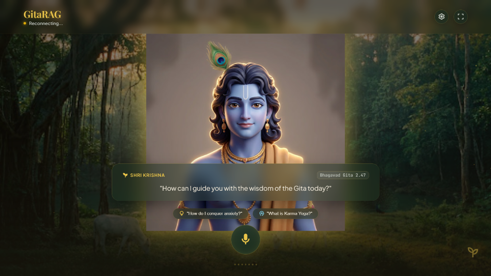
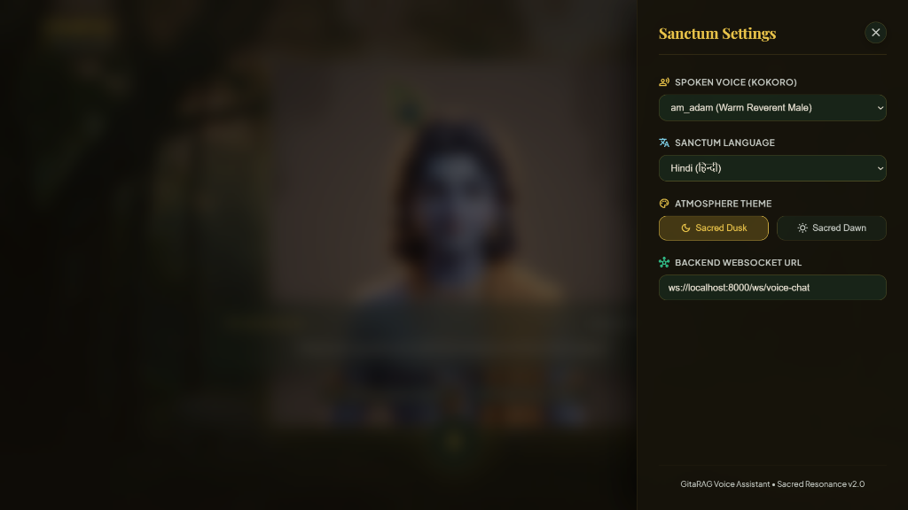
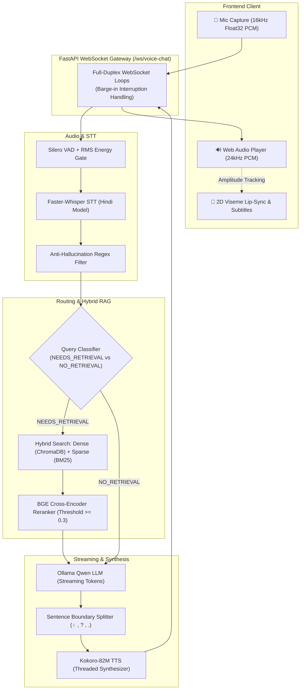

<div align="center">

# 🕉️ GitaRAG: Real-Time Voice-Interactive AI Assistant

**A low-latency, voice-first spiritual companion embodying the wisdom of the Bhagavad Gita.**  
Built with Faster-Whisper (STT), Silero VAD, Multi-Stage Hybrid RAG, Streaming Open source LLMs, Kokoro-82M (TTS), and real-time lip-sync viseme animation.

---

<!-- UI SHOWCASE -->
<p align="center">
  
  <br />
  <em><b>Divine Darshan Interface:</b> Real-time voice interaction with animated avatar & live subtitles</em>
</p>

<p align="center">
  
  <br />
  <em><b>Sanctum Settings:</b> Kokoro voice profile selection, language, themes & WebSocket controls</em>
</p>

---

[](https://www.python.org/)
[](https://fastapi.tiangolo.com/)
[](https://www.trychroma.com/)
[](https://github.com/SYSTRAN/faster-whisper)
[](https://huggingface.co/hexgrad/Kokoro-82M)
[](https://ollama.com/)

</div>

---

## ⚡ Overview

**GitaRAG** is a full-duplex conversational voice assistant delivering scripture-grounded counsel from the Bhagavad Gita in spoken Hindi.

- **Empathetic Persona**: Speaks as Lord Krishna—prioritizing compassion first, followed by tailored Gita wisdom without mechanical verse citations.
- **Pipelined Low Latency**: LLM tokens are chunked by sentence and synthesized by Kokoro TTS concurrently, enabling instant audio playback while the rest of the reply generates.
- **Barge-In Interruption**: Real-time energy and VAD gating allow users to interrupt speech mid-stream.
- **Interactive Darshan UI**: Animated Krishna avatar with dynamic 2D lip-sync visemes synchronized to output audio amplitude.

---

## 🏗️ Architecture & Pipeline

### Pipeline Flow



### Component Stack

| Stage | Technology | Function |
|---|---|---|
| **VAD & Audio Gating** | Silero VAD + RMS Energy | Filters silence, buffers voice frames, detects user barge-in |
| **Speech-to-Text (STT)**| Faster-Whisper (`whisper-base`) | Transcribes Hindi audio with context prompts & hallucination guards |
| **Query Routing** | Groq / LLM Router | Classifies query into `NEEDS_RETRIEVAL` or `NO_RETRIEVAL` |
| **Hybrid Retrieval** | ChromaDB + BM25 | Combines dense embeddings (`bge-small-en-v1.5`) & sparse keywords (0.6 / 0.4) |
| **Re-ranking** | `BAAI/bge-reranker-base` | Scores relevance via cross-attention; filters low-score noise |
| **LLM Generation** | Ollama (`qwen2.5:1.5b`) | Generates conversational Hindi responses streamed token-by-token |
| **Text-to-Speech (TTS)**| Kokoro-82M (`hm_omega` voice) | Streams 24kHz Float32 PCM speech concurrent with LLM generation |
| **Frontend UI** | HTML5 / CSS / Vanilla JS | 2D mouth viseme animations, particles, and live subtitle drawer |

---

## 📁 Repository Structure

```
gita-assist-voice-rag/
├── data/
│   ├── raw.json               # 700+ verses & commentaries with emotion/intent metadata
│   ├── data_preparation.py   # Dataset chunking & schema enrichment
│   └── index/                 # Persistent ChromaDB vector storage
├── frontend/                  # Sanctum web client (HTML, CSS, JS, Assets)
├── src/
│   ├── config.py              # Central settings (models, sample rates, thresholds)
│   ├── main.py                # FastAPI app, WebSocket handlers & state management
│   ├── audio/                 # VAD, Faster-Whisper STT, and Kokoro TTS wrappers
│   ├── llm/                   # Ollama client, query classifier & Krishna prompt templates
│   └── rag/                   # Hybrid retriever pipeline & ChromaDB indexing
├── utils/                     # Embeddings, BM25, and Cross-Encoder helpers
├── download_models.py         # One-click neural models downloader
├── temp_main.py               # CLI RAG pipeline testing script
└── pyproject.toml             # Project dependencies
```

---

## 🚀 Quickstart Guide

### 1. Prerequisites
- **Python 3.12+**
- **NVIDIA GPU with CUDA 12.1+** (recommended) or CPU
- **Ollama** ([Download here](https://ollama.com/))
- **Groq API Key** ([Get free key](https://console.groq.com/))

### 2. Clone & Setup Environment

```bash
git clone https://github.com/your-username/gita-assist-voice-rag.git
cd gita-assist-voice-rag

# Create virtual environment
python -m venv .venv

# Activate environment (Windows)
.venv\Scripts\activate
# Activate environment (Linux / macOS)
source .venv/bin/activate

# Install dependencies (using uv or pip)
pip install -e .
```

### 3. Configure Environment Variables

Create `.env` from the template:
```bash
cp .env.example .env
```
Add your Groq API key inside `.env`:
```ini
GROQ_API_KEY="your_groq_api_key_here"
```

### 4. Download Neural Models

Download all local neural weights (Whisper, BGE, Silero, Kokoro) with one command:
```bash
python download_models.py --all
```

### 5. Pull & Start Ollama LLM

In a separate terminal:
```bash
# Start Ollama service
ollama serve

# Pull default Hindi-capable LLM
ollama run qwen2.5:1.5b
```

### 6. Run the Application

#### Step A: Start FastAPI Backend
```bash
uvicorn src.main:app --host 0.0.0.0 --port 8000 --reload
```
*(ChromaDB vector store will build automatically on first run).*

#### Step B: Start Frontend Client
In a new terminal:
```bash
python -m http.server 3000 --directory frontend
```

Open **`http://localhost:3000`** in Chrome or Edge, grant microphone permission, and tap the lotus mic button to speak!

---

## 🛠️ Testing the Pipeline (CLI)

Test the RAG retrieval, cross-encoder, and LLM response directly in terminal without voice:
```bash
python temp_main.py
```

---

## 📜 License & Acknowledgments

- **Dataset**: Bhagavad Gita verses, transliterations, and authentic commentaries.
- **Models**: [Faster-Whisper](https://github.com/SYSTRAN/faster-whisper), [Kokoro-82M](https://huggingface.co/hexgrad/Kokoro-82M), [BAAI BGE](https://huggingface.co/BAAI), [Silero VAD](https://github.com/snakers4/silero-vad).
